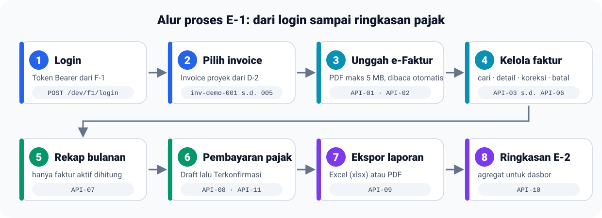

<p align="center">
  
</p>

<p align="center">
  <b>Pencatatan e-Faktur dan pajak proyek</b> untuk ERP PT Anaheim Nimbus Universal<br>
  Capstone PPL · Kelas E · Kelompok 1
</p>

<p align="center">
  
  
  
  
  
  
</p>

---

<a id="daftar-isi"></a>
## 📑 Daftar isi

1. [🎯 Tentang proyek](#tentang-proyek)
2. [✨ Fitur utama](#fitur-utama)
3. [🗺️ Alur proses](#alur-proses)
4. [🧰 Teknologi dan prasyarat](#teknologi)
5. [🚀 Instalasi dan menjalankan](#instalasi)
6. [⚙️ Konfigurasi `.env`](#konfigurasi)
7. [🔐 Login dan hak akses](#login)
8. [📡 Daftar 11 API](#daftar-api)
9. [🧪 Tutorial menguji setiap API](#tutorial)
    - [🧱 Persiapan pengujian](#t-persiapan)
    - [🔑 Login](#t-login)
    - [🔍 API-KE01-01 Pratinjau ekstraksi PDF](#t-api01)
    - [💾 API-KE01-02 Simpan faktur atau faktur pengganti](#t-api02)
    - [🔎 API-KE01-03 Cari dan filter faktur](#t-api03)
    - [📄 API-KE01-04 Detail faktur](#t-api04)
    - [✏️ API-KE01-05 Koreksi atau batalkan faktur](#t-api05)
    - [🕘 API-KE01-06 Riwayat perubahan](#t-api06)
    - [📅 API-KE01-07 Rekap per masa pajak](#t-api07)
    - [💳 API-KE01-08 Catat pembayaran pajak](#t-api08)
    - [✅ API-KE01-11 Lengkapi pembayaran](#t-api11)
    - [📤 API-KE01-09 Ekspor rekap](#t-api09)
    - [📊 API-KE01-10 Ringkasan pajak](#t-api10)
    - [🔁 Variasi data lain](#t-variasi)
    - [📮 Menguji lewat Postman](#t-postman)
10. [❌ Kode kesalahan](#kode-kesalahan)
11. [📏 Aturan bisnis](#aturan-bisnis)
12. [✅ Pengujian otomatis](#pengujian-otomatis)
13. [🗂️ Struktur proyek](#struktur)
14. [🧩 Integrasi D-2 dan ekstraksi PDF](#integrasi)
15. [📝 Keputusan dan hal terbuka](#keputusan)
16. [🛠️ Pemecahan masalah](#troubleshooting)
17. [👥 Tim](#tim)

<a id="tentang-proyek"></a>
## Antarmuka web Blade

Seluruh panduan dan dokumen acuan tersedia di [Indeks dokumentasi](docs/README.md).
Keputusan demo lokal dan penyelarasan spesifikasi/kontrak PDF dicatat dalam
[Adendum E-1 v0.3](docs/acuan/ADENDUM_DEMO_E1_v0.3.md)
([versi PDF](docs/acuan/ADENDUM_DEMO_E1_v0.3.pdf)).

Antarmuka E-1 tersedia di `/login` dan menggunakan Blade, Tailwind CSS, Solar Icons,
serta komponen Blade dengan desain shadcn/ui. Data dibaca dan disimpan melalui 11 API yang tersedia.

```bash
npm ci
npm run build
composer serve
```

Buka `http://127.0.0.1:8080/login`. Gunakan token F-1, atau akun demo lokal bila
`E1_DEV_LOGIN=true`. `npm run dev` dapat dipakai selama pengembangan sebagai pengganti build.

Aturan rekap mengikuti Rancangan Antarmuka v0.2: faktur **Normal dan Pengganti aktif**
dihitung; faktur Dibatalkan dan faktur asal terganti tetap terlihat tetapi tidak dijumlahkan.
Setelah memperbarui aplikasi yang sudah memiliki data, jalankan:

```bash
php artisan e1:recaps:rebuild
```

Route, batasan integrasi, pengujian, dan keputusan desain tersedia di [Panduan UI Blade](docs/panduan/UI_BLADE.md).

Untuk mengisi demo UI, jalankan `php artisan db:seed` lalu `php artisan demo:samples`.
Seeder menambahkan data yang belum ada tanpa menghapus edit pengguna: 32 faktur,
5 pembayaran, dan 5 masa pajak pada database kosong. Invoice `inv-demo-006` dan
`inv-demo-007` disisakan untuk pencatatan baru. Lihat [Panduan Seeder Demo](docs/panduan/DEMO_SEEDER.md).

Untuk menguji flow dari invoice yang belum pernah dipakai, jalankan
`php artisan demo:flow`. Perintah ini menambahkan empat invoice mock D-2 baru,
tanpa mencatat faktur E-1, serta membuat PDF, panduan, dan checklist dalam
`docs/testing-invoice-flow/<batch>/`. Dropdown pencatatan hanya menampilkan invoice
tanpa faktur keluaran aktif. Lihat [Paket Pengujian Invoice](docs/testing-invoice-flow/README.md).

## 🎯 Tentang proyek

Modul **E-1** mencatat **Faktur Pajak Keluaran (e-Faktur)** dari berkas PDF yang dibuat di luar sistem, menautkannya ke invoice
proyek dari **D-2**, lalu merekap pajak per masa pajak sampai pembayarannya terdokumentasi.

| Modul | Hubungan dengan E-1 |
|---|---|
| 🔑 **F-1** (identitas) | menerbitkan token Bearer dan peran pengguna |
| 📄 **D-2** (kontrak dan invoice) | sumber data invoice yang dipilih saat mencatat faktur |
| 📊 **E-2** (arus kas dan dasbor) | konsumen API ringkasan pajak (API-KE01-10) |

> [!NOTE]
> E-1 **tidak menerbitkan** e-Faktur dan **tidak terhubung langsung ke DJP**. E-1 hanya mencatat dari PDF.

<p align="right"><sub><a href="#daftar-isi">⬆ Kembali ke daftar isi</a></sub></p>

<a id="fitur-utama"></a>
## ✨ Fitur utama

- 📥 **Unggah PDF e-Faktur**: NSFP, tanggal, DPP, PPN, PPnBM, dan item dibaca otomatis.
- 🔗 **Satu invoice : satu faktur aktif**; NSFP tidak boleh ganda.
- ✏️ **Koreksi, pembatalan, dan faktur pengganti** dengan riwayat siapa, kapan, sebelum, dan sesudah. Tidak ada hapus permanen.
- 🔎 **Cari dan filter**: nomor faktur, proyek, klien, masa pajak, status, plus paging.
- 📅 **Rekap bulanan**: hanya faktur aktif yang dijumlahkan; faktur dibatalkan atau terganti tetap terlihat.
- 💳 **Pembayaran pajak**: jumlah setor, billing, NTPN, e-Billing, dan bukti; Draft lalu Terkonfirmasi; selisih selalu ditampilkan.
- 📤 **Ekspor** rekap ke Excel dan PDF dengan isi yang sama dengan rekap.
- 🔌 **API ringkasan** agregat untuk modul lain (E-2).

<p align="right"><sub><a href="#daftar-isi">⬆ Kembali ke daftar isi</a></sub></p>

<a id="alur-proses"></a>
## 🗺️ Alur proses

<p align="center">
  
</p>

<p align="right"><sub><a href="#daftar-isi">⬆ Kembali ke daftar isi</a></sub></p>

<a id="teknologi"></a>
## 🧰 Teknologi dan prasyarat

| Komponen | Versi / keterangan |
|---|---|
| PHP | 8.4 dengan ekstensi `pdo_pgsql`, `mbstring`, `bcmath`, `gd`, `zip`, `fileinfo`, `openssl` |
| Composer | 2.x |
| PostgreSQL | 16 atau lebih baru (diuji pada 18) |
| Laravel | 13 |
| Alat uji | Postman, atau `curl` lewat Git Bash |

Pustaka utama: `firebase/php-jwt` (token F-1), `smalot/pdfparser` (baca PDF), `maatwebsite/excel` (Excel), `barryvdh/laravel-dompdf` (PDF).

<p align="right"><sub><a href="#daftar-isi">⬆ Kembali ke daftar isi</a></sub></p>

<a id="instalasi"></a>
## 🚀 Instalasi dan menjalankan

1. **Ambil dependensi**

   ```bash
   composer install
   ```

2. **Siapkan `.env`**

   ```bash
   cp .env.example .env
   php artisan key:generate
   ```

3. **Jalankan PostgreSQL dengan Docker Compose**

   Compose membaca `DB_DATABASE`, `DB_USERNAME`, `DB_PASSWORD`, dan `DB_PORT` dari
   `.env`. Gunakan `DB_HOST=127.0.0.1` dan `DB_PORT=15439` untuk Laravel di host.

   ```bash
   docker compose up -d --wait postgres
   ```

   Data disimpan dalam volume `postgres_data` dan tetap ada setelah container dihentikan.
   Port hanya tersedia di localhost. Jika akses socket Docker ditolak, jalankan
   perintah Docker dengan `sudo`. Database dan akun dibuat pada inisialisasi volume
   pertama; perubahan kredensial di `.env` tidak mengubah akun pada volume yang sudah ada.

   Untuk memakai PostgreSQL yang sudah terpasang, sesuaikan `DB_PORT` dan buat role
   serta database secara manual (akan meminta password superuser `postgres`):

   ```bash
   psql -U postgres -c "CREATE ROLE e1_app LOGIN PASSWORD 'e1_dev_pass' CREATEDB;"
   psql -U postgres -c "CREATE DATABASE e1_pajak OWNER e1_app;"
   psql -U postgres -c "CREATE DATABASE e1_pajak_test OWNER e1_app;"
   ```

   > [!TIP]
   > Di Windows, `psql` ada di `C:\Program Files\PostgreSQL\<versi>\bin\psql.exe`. Nama role, database, dan password di atas
   > sesuai bawaan `.env.example` (`DB_USERNAME`, `DB_DATABASE`, `DB_PASSWORD`).

4. **Buat tabel**

   ```bash
   php artisan migrate                 # membuat tabel tanpa menghapus data
   php artisan db:seed                 # opsional: menambahkan paket demo UI
   ```

   Tutorial Postman menggunakan database kosong tersendiri. `migrate:fresh` menghapus
   seluruh data dan tidak diperlukan untuk melengkapi demo UI.

5. **Jalankan server**

   ```bash
   composer serve                       # http://127.0.0.1:8080
   ```

6. **Periksa**

   ```bash
   curl http://127.0.0.1:8080/up        # HTTP 200 berarti aplikasi hidup
   ```

7. **Berkas PDF contoh** ada di [`docs/postman/samples/`](docs/postman/samples). Bila hilang, buat ulang dengan `php artisan demo:samples`.

> [!IMPORTANT]
> Jalankan dengan `composer serve`, bukan `php artisan serve`. Perintah ini menaikkan batas unggah PHP (`upload_max_filesize=6M`)
> sehingga berkas sampai 5 MB (batas aplikasi) dapat diterima. Batas bawaan PHP hanya 2 MB.

<p align="right"><sub><a href="#daftar-isi">⬆ Kembali ke daftar isi</a></sub></p>

<a id="konfigurasi"></a>
## ⚙️ Konfigurasi `.env`

| Variabel | Bawaan | Fungsi |
|---|---|---|
| `DB_*` | `127.0.0.1:5432`, `e1_pajak`, `e1_app` | koneksi PostgreSQL |
| `F1_JWT_ALGO` | `HS256` | algoritma token (`HS256` atau `RS256`) |
| `F1_JWT_SECRET` | rahasia contoh | rahasia bersama HS256 (ganti; minimal 32 karakter) |
| `F1_JWT_PUBLIC_KEY_PATH` | kosong | kunci publik F-1 untuk `RS256` |
| `F1_JWT_ISSUER`, `F1_JWT_AUDIENCE` | `f1-identity`, `erp-anaheim` | `iss` dan `aud` yang diterima |
| `F1_CLAIM_AKUN_ID`, `F1_CLAIM_ROLE` | `akunId`, `kodePeran` | nama klaim identitas dan peran |
| `E1_ALLOWED_ROLES` | `Admin,CEO,COO` | peran yang berhak mengakses modul |
| `E1_SUMMARY_EXTRA_ROLES` | kosong | peran layanan (mis. `LayananE2`) yang hanya boleh membaca API-KE01-10 |
| `E1_DEV_LOGIN` | `true` pada contoh | menyalakan login tiruan F-1 (hanya lokal) |
| `D2_DRIVER` | `mock` | `mock` (data fiktif) atau `http` (layanan D-2 sebenarnya) |
| `D2_BASE_URL`, `D2_INVOICE_PATH` | kosong | alamat D-2 bila `D2_DRIVER=http` |
| `E1_UPLOAD_MAX_KB` | `5120` | batas ukuran PDF (5 MB) |

Setelah mengubah `.env`, bila perilaku tidak berubah jalankan `php artisan config:clear`.

<p align="right"><sub><a href="#daftar-isi">⬆ Kembali ke daftar isi</a></sub></p>

<a id="login"></a>
## 🔐 Login dan hak akses

E-1 **tidak memiliki endpoint login**: login dimiliki **F-1**. Semua API E-1 meminta header berikut, dan token diperiksa
tanda tangan, `exp` (wajib), `iss`, dan `aud`-nya.

```http
Authorization: Bearer <token F-1>
```

| Kondisi | Hasil |
|---|---|
| Token tidak ada, rusak, atau kedaluwarsa | **401** `UNAUTHORIZED` |
| Token sah, peran bukan Admin, CEO, atau COO | **403** `FORBIDDEN` |
| Peran Admin, CEO, atau COO | akses penuh (hak sama sementara; matriks per aksi menunggu Q-19) |

### Login tiruan untuk lokal

Karena F-1 belum tersedia, tersedia login tiruan (aktif bila `E1_DEV_LOGIN=true`, **tidak pernah aktif di production**):

```http
POST /api/dev/f1/login
Content-Type: application/json

{ "akunId": "AKN-0002", "kodePeran": "Admin" }
```

Alternatif lewat terminal: `php artisan f1:token AKN-0002 Admin` (mencetak token yang sama).

<p align="right"><sub><a href="#daftar-isi">⬆ Kembali ke daftar isi</a></sub></p>

<a id="daftar-api"></a>
## 📡 Daftar 11 API

Semua path berawalan `/api/v1`. Sukses selalu **HTTP 200**. Kontrak lengkap ada di [`openapi.yaml`](openapi.yaml)
dan contoh respons di [`examples/`](examples).

| ID | Metode dan path | Fungsi |
|---|---|---|
| **API-KE01-01** | `POST /tax-invoices/extractions` | 🔍 Pratinjau hasil baca PDF (tidak menyimpan) |
| **API-KE01-02** | `POST /tax-invoices/outgoing` | 💾 Simpan faktur keluaran atau faktur pengganti |
| **API-KE01-03** | `GET /tax-invoices` | 🔎 Cari dan filter faktur |
| **API-KE01-04** | `GET /tax-invoices/{taxInvoiceId}` | 📄 Detail faktur, item, dan tautan asal/pengganti |
| **API-KE01-05** | `PATCH /tax-invoices/{taxInvoiceId}` | ✏️ Koreksi atau batalkan faktur |
| **API-KE01-06** | `GET /tax-invoices/{taxInvoiceId}/history` | 🕘 Riwayat perubahan |
| **API-KE01-07** | `GET /tax-recaps/{taxPeriod}` | 📅 Rekap per masa pajak |
| **API-KE01-08** | `POST /tax-payments` | 💳 Catat pembayaran pajak (Draft atau Terkonfirmasi) |
| **API-KE01-09** | `GET /tax-recaps/{taxPeriod}/export?format=xlsx\|pdf` | 📤 Ekspor rekap |
| **API-KE01-10** | `GET /tax/summary?taxPeriod=&projectId=` | 📊 Ringkasan pajak untuk modul lain (E-2) |
| **API-KE01-11** | `PATCH /tax-payments/{taxPaymentId}` | ✅ Lengkapi pembayaran menjadi Terkonfirmasi |

**Bentuk respons** (aturan bersama):

```jsonc
// sukses
{ "code": "200", "message": "Faktur tersimpan", "data": { /* ... */ } }

// gagal
{ "code": "409", "message": "NSFP sudah terdaftar", "data": null, "errorCode": "DUPLICATE_NSFP" }
```

**Format nilai:** nominal pada input berupa **string** desimal (`"11000000.00"`), sedangkan respons menampilkan format Indonesia (`"11.000.000,00"`). Tanggal `YYYY-MM-DD`, masa pajak `YYYY-MM`,
waktu RFC 3339 UTC (`...Z`), dan ID memakai UUID v7.

<p align="right"><sub><a href="#daftar-isi">⬆ Kembali ke daftar isi</a></sub></p>

<a id="tutorial"></a>
## 🧪 Tutorial menguji setiap API di Postman

Panduan ini menguji **11 API E-1** dari awal sampai akhir. Gunakan database **demo yang boleh dikosongkan** agar request tulis menghasilkan `200`, bukan `409` karena invoice atau NSFP sudah tercatat. ID UUID pada respons selalu berbeda; simpan ID dari respons sendiri, jangan menyalin ID contoh.

<a id="t-persiapan"></a>
### 1. Persiapan Postman dan database

1. Pastikan PostgreSQL aktif dan nilai `DB_*` di `.env` benar. Jalankan `php artisan migrate:status` untuk memeriksa koneksi.
2. Pada **database demo yang boleh dihapus**, jalankan `php artisan migrate:fresh` dari folder proyek. Perintah ini menghapus tabel dan data E-1 lalu membuatnya kembali. **Jangan tambahkan `--seed`** untuk alur lengkap di bawah: seeder demo sudah mengisi seluruh invoice mock `inv-demo-001` sampai `inv-demo-005`, sehingga API-KE01-01/02 akan menolak pencatatan ulang.
3. Jalankan `composer serve`, lalu pastikan `http://127.0.0.1:8080/up` menjawab HTTP `200`.
4. Import [`docs/postman/E1-API.postman_collection.json`](docs/postman/E1-API.postman_collection.json) dan, bila perlu, [`E1-Local.postman_environment.json`](docs/postman/E1-Local.postman_environment.json). Pilih environment **E-1 Lokal**.
5. Di Postman, buka **Settings → General → Working directory** dan pilih folder `docs/postman`. Pada field bertipe **File**, pilih PDF dari `docs/postman/samples/` jika Postman belum menemukannya.

Atur variabel environment berikut. Nilai ID akan diperoleh dari respons pada langkah selanjutnya.

| Variabel | Nilai awal | Kegunaan |
|---|---|---|
| `baseUrl` | `http://127.0.0.1:8080` | Alamat server lokal |
| `token` | kosong | Token Bearer dari login |
| `taxInvoiceId` | kosong | ID faktur A (`inv-demo-001`) |
| `originalTaxInvoiceId` | kosong | ID faktur C sebelum diganti |
| `replacementTaxInvoiceId` | kosong | ID faktur pengganti C2 |
| `cancelTaxInvoiceId` | kosong | ID faktur D yang akan dibatalkan |
| `taxPaymentId` | kosong | ID pembayaran Draft November |

Untuk **semua request selain login**, gunakan tab **Authorization → Bearer Token → `{{token}}`** dan header `Accept: application/json`. Untuk body **form-data**, pilih tab **Body → form-data**, ubah field PDF menjadi tipe **File**, lalu pilih berkasnya. Biarkan Postman mengisi `Content-Type` beserta boundary secara otomatis. Untuk body JSON, pilih **Body → raw → JSON**.

Urutan ringkas: **login → ekstraksi A → simpan A, B, C, D, E → pengganti C2 → daftar/detail/koreksi/riwayat → batalkan D → rekap → pembayaran Draft → lengkapi pembayaran → ekspor → ringkasan**. Jangan menjalankan request tulis yang sama dua kali tanpa mengosongkan database demo karena NSFP dan faktur aktif harus unik.

<a id="t-login"></a>
### 2. Login lokal dan simpan token

| Metode | URL | Authorization | Body |
|---|---|---|---|
| `POST` | `{{baseUrl}}/api/dev/f1/login` | **No Auth** | raw JSON di bawah |

```json
{"akunId":"AKN-0002","kodePeran":"Admin","ttl":3600}
```

Respons sukses: HTTP `200`, `code: "200"`, dan `data.accessToken` terisi. Pada tab **Scripts → Post-response** request login, tambahkan:

```javascript
pm.environment.set('token', pm.response.json().data.accessToken);
```

Login ini adalah tiruan F-1 khusus lokal (`E1_DEV_LOGIN=true`). Jika `404`, periksa nilai itu di `.env` dan jalankan `php artisan config:clear`. Token berlaku selama `ttl` detik; login lagi bila API menjawab `401`.

<a id="t-api01"></a>
### 3. API-KE01-01 — Pratinjau ekstraksi PDF

| Metode | URL | Body form-data |
|---|---|---|
| `POST` | `{{baseUrl}}/api/v1/tax-invoices/extractions` | `invoiceId` (Text) = `inv-demo-001`; `eFakturFile` (File) = `samples/efaktur-inv-demo-001.pdf` |

Respons: HTTP `200`; `data.taxInvoiceNumber = "010.000-26.12345678"`, `data.taxInvoiceDate = "2026-11-01"`, `data.taxPeriod = "2026-11"`, `data.dpp = "100.000.000,00"`, dan `data.ppn = "11.000.000,00"`. Pratinjau tidak menyimpan faktur. Jalankan langkah ini **sebelum** API-KE01-02 untuk `inv-demo-001`.

<a id="t-api02"></a>
### 4. API-KE01-02 — Simpan faktur dan faktur pengganti

Semua request pada tabel memakai `POST {{baseUrl}}/api/v1/tax-invoices/outgoing` dengan body **form-data**. Field `invoiceId` dan `replacesTaxInvoiceId` bertipe **Text**; `eFakturFile` bertipe **File**. Jalankan **dari atas ke bawah**.

| Langkah | `invoiceId` | `eFakturFile` | `replacesTaxInvoiceId` | Simpan `data.taxInvoiceId` ke |
|---|---|---|---|---|
| A | `inv-demo-001` | `samples/efaktur-inv-demo-001.pdf` | kosong | `taxInvoiceId` |
| B | `inv-demo-002` | `samples/efaktur-inv-demo-002.pdf` | kosong | opsional |
| C (asal) | `inv-demo-003` | `samples/efaktur-inv-demo-003.pdf` | kosong | `originalTaxInvoiceId` |
| D | `inv-demo-004` | `samples/efaktur-inv-demo-004.pdf` | kosong | `cancelTaxInvoiceId` |
| E | `inv-demo-005` | `samples/efaktur-inv-demo-005.pdf` | kosong | opsional |
| C2 (pengganti) | `inv-demo-003` | `samples/efaktur-inv-demo-003-pengganti.pdf` | `{{originalTaxInvoiceId}}` | `replacementTaxInvoiceId` |

Setelah respons `200`, salin `data.taxInvoiceId` ke variabel yang disebutkan. Untuk otomatisasi, tambahkan skrip berikut pada tab **Scripts → Post-response** request A; ganti nama variabel pada request C, D, dan C2:

```javascript
pm.environment.set('taxInvoiceId', pm.response.json().data.taxInvoiceId);
```

Hasil: A, B, D, E berstatus `NORMAL`; C2 berstatus `REPLACEMENT` dan menunjuk C. Total ada **6 baris faktur**; C tidak dihitung lagi pada rekap. Jika mendapat `409`, database demo sudah berisi faktur atau NSFP yang sama.

<a id="t-api03"></a>
### 5. API-KE01-03 — Daftar dan filter faktur

| Metode | URL | Body | Hasil |
|---|---|---|---|
| `GET` | `{{baseUrl}}/api/v1/tax-invoices` | tidak ada | `data.pagination.totalItems = 6` |
| `GET` | `{{baseUrl}}/api/v1/tax-invoices?taxPeriod=2026-11&status=NORMAL` | tidak ada | A, B, dan C (asal yang sudah diganti), `totalItems = 3` |
| `GET` | `{{baseUrl}}/api/v1/tax-invoices?project=gudang&client=Lintas&page=1&pageSize=2` | tidak ada | Filter proyek, klien, dan paging |

Semua query opsional: `taxInvoiceNumber` (mis. `12345678`), `project` (ID/nama), `client` (ID/nama), `taxPeriod` (`YYYY-MM`), `status` (`NORMAL`, `REPLACEMENT`, `CANCELLED`), `page` (mulai `1`), dan `pageSize` (maksimal `100`).

<a id="t-api04"></a>
### 6. API-KE01-04 — Detail faktur

| Metode | URL | Body | Hasil |
|---|---|---|---|
| `GET` | `{{baseUrl}}/api/v1/tax-invoices/{{taxInvoiceId}}` | tidak ada | Detail A dan daftar `items` |
| `GET` | `{{baseUrl}}/api/v1/tax-invoices/{{originalTaxInvoiceId}}` | tidak ada | `replacedByTaxInvoiceId` menunjuk C2 |

Kedua URL harus menjawab HTTP `200`. ID diambil dari respons API-KE01-02, bukan nomor faktur.

<a id="t-api05"></a>
### 7. API-KE01-05 — Koreksi dan pembatalan faktur

| Metode | URL | Body | Hasil |
|---|---|---|---|
| `PATCH` | `{{baseUrl}}/api/v1/tax-invoices/{{taxInvoiceId}}` | raw JSON koreksi di bawah | A berubah tanggal, `auditId` terisi |
| `PATCH` | `{{baseUrl}}/api/v1/tax-invoices/{{cancelTaxInvoiceId}}` | raw JSON pembatalan di bawah | D berstatus `CANCELLED` |

Koreksi A:

```json
{"changes":{"taxInvoiceDate":"2026-11-10"},"note":"Koreksi tanggal faktur"}
```

Pembatalan D:

```json
{"changes":{"status":"CANCELLED"},"note":"Salah klien; faktur dibatalkan"}
```

Keduanya menjawab HTTP `200`. Field dalam `changes` dapat berupa `taxInvoiceNumber`, `taxInvoiceDate`, `taxPeriod`, `dpp`, `ppn`, `ppnbm`, `items`, atau `status: "CANCELLED"`. Nominal harus **string** desimal dua digit, misalnya `"90000000.00"`. Jangan gabungkan pembatalan dengan koreksi field lain.

<a id="t-api06"></a>
### 8. API-KE01-06 — Riwayat perubahan

| Metode | URL | Body | Hasil |
|---|---|---|---|
| `GET` | `{{baseUrl}}/api/v1/tax-invoices/{{taxInvoiceId}}/history` | tidak ada | HTTP `200`; A memiliki aksi `CREATE` dan `UPDATE` |
| `GET` | `{{baseUrl}}/api/v1/tax-invoices/{{cancelTaxInvoiceId}}/history` | tidak ada | HTTP `200`; D memiliki aksi `CREATE` dan `STATUS_CHANGE` |

Periksa `data.history[*].actorAkunId`, `beforeSnapshot`, `afterSnapshot`, dan `note` untuk melihat perubahan yang tercatat.

<a id="t-api07"></a>
### 9. API-KE01-07 — Rekap masa pajak

| Metode | URL | Hasil setelah langkah 7 |
|---|---|---|
| `GET` | `{{baseUrl}}/api/v1/tax-recaps/2026-11` | `invoiceCount = 3`, `totalDpp = "420.000.000,00"`, `totalPpn = "46.200.000,00"` |
| `GET` | `{{baseUrl}}/api/v1/tax-recaps/2026-12` | `invoiceCount = 1`, `totalPpn = "6.600.000,00"`; D tetap tampil dengan `isCounted = false` |
| `GET` | `{{baseUrl}}/api/v1/tax-recaps/2026-01` | HTTP `200`, rekap kosong dengan nilai nol |

Body tidak ada. Sebelum mencatat pembayaran, `data.recap.paymentStatus` bernilai `NOT_RECORDED`.

<a id="t-api08"></a>
### 10. API-KE01-08 — Catat pembayaran pajak

Metode dan URL: `POST {{baseUrl}}/api/v1/tax-payments`. Gunakan body **form-data**:

| Field | Tipe | Pembayaran Draft November | Pembayaran langsung terkonfirmasi Desember |
|---|---|---|---|
| `taxPeriod` | Text | `2026-11` | `2026-12` |
| `taxYear` | Text | `2026` | `2026` |
| `amountPaid` | Text | `46200000.00` | `6000000.00` |
| `billingId` | Text | `BILL-202611-001` | `BILL-202612-001` |
| `eBillingFile` | File | `samples/e-billing.pdf` | `samples/e-billing.pdf` |
| `ntpn` | Text | kosong | `NTPN-XYZ987654` |
| `paymentProofFile` | File | kosong | `samples/bukti-pembayaran.pdf` |

Jalankan **Draft November terlebih dahulu**, lalu simpan `data.taxPaymentId` ke `taxPaymentId` dengan skrip Post-response:

```javascript
pm.environment.set('taxPaymentId', pm.response.json().data.taxPaymentId);
```

Draft menjawab HTTP `200`, `data.status = "INCOMPLETE"`, dan `data.paymentDifference = "0,00"`. Pembayaran Desember juga menjawab `200`, langsung `CONFIRMED`, dan selisih `"-600.000,00"` karena PPN Desember `6.600.000,00`.

<a id="t-api11"></a>
### 11. API-KE01-11 — Lengkapi pembayaran Draft

| Metode | URL | Body form-data | Hasil |
|---|---|---|---|
| `PATCH` | `{{baseUrl}}/api/v1/tax-payments/{{taxPaymentId}}` | `ntpn` (Text) = `NTPN-ABC123456`; `paymentProofFile` (File) = `samples/bukti-pembayaran.pdf` | HTTP `200`, `data.status = "CONFIRMED"` |

Gunakan **PATCH** dengan form-data, bukan POST. Setelah berhasil, ulangi `GET {{baseUrl}}/api/v1/tax-recaps/2026-11`: `data.recap.paymentStatus = "CONFIRMED"` dan `amountPaid = "46.200.000,00"`.

<a id="t-api09"></a>
### 12. API-KE01-09 — Ekspor rekap

| Metode | URL | Respons |
|---|---|---|
| `GET` | `{{baseUrl}}/api/v1/tax-recaps/2026-11/export?format=xlsx` | HTTP `200`, berkas Excel `.xlsx` |
| `GET` | `{{baseUrl}}/api/v1/tax-recaps/2026-11/export?format=pdf` | HTTP `200`, berkas PDF `.pdf` |

Body tidak ada. Di Postman, gunakan **Send and Download** untuk menyimpan berkas. Respons sukses berupa **berkas biner**, sehingga tidak memakai amplop JSON `{code,message,data}`.

<a id="t-api10"></a>
### 13. API-KE01-10 — Ringkasan pajak

| Metode | URL | Hasil setelah pembayaran lengkap |
|---|---|---|
| `GET` | `{{baseUrl}}/api/v1/tax/summary?taxPeriod=2026-11` | HTTP `200`, `invoiceCount = 3`, `totalPpn = "46.200.000,00"`, `paymentStatus = "CONFIRMED"` |
| `GET` | `{{baseUrl}}/api/v1/tax/summary?taxPeriod=2026-11&projectId=prj-demo-002` | HTTP `200`, ringkasan hanya proyek gudang |

Body tidak ada. `taxPeriod` wajib berformat `YYYY-MM`; `projectId` opsional dan harus dikenal D-2/E-1. Token peran layanan E-2 dapat dipakai bila `E1_SUMMARY_EXTRA_ROLES` dikonfigurasi.

<a id="t-variasi"></a>
### 14. Uji variasi dan hasil gagal yang diharapkan

Setelah semua alur sukses, coba contoh berikut. Respons gagal tetap memakai `{code,message,data,errorCode}`; status `4xx` pada kasus ini **bukan** error server.

| Request | Perubahan | Status / `errorCode` |
|---|---|---|
| API-KE01-01 | `eFakturFile` = `samples/bukan-pdf.txt` | `400 INVALID_FILE` |
| API-KE01-02 | Simpan lagi `inv-demo-001` tanpa `replacesTaxInvoiceId` | `409 INVOICE_ALREADY_HAS_ACTIVE_TAX_INVOICE` |
| API-KE01-03 | `?taxPeriod=2026-13` | `400 INVALID_FILTER` |
| API-KE01-04 | ID faktur `abc` | `404 TAX_INVOICE_NOT_FOUND` |
| API-KE01-05 | `changes.dpp` berupa angka `90000000`, bukan string | `400 INVALID_CHANGE` |
| API-KE01-07 | `/tax-recaps/2026-13` | `400 INVALID_TAX_PERIOD` |
| API-KE01-09 | `?format=csv` | `400 INVALID_FORMAT` |
| Semua API E-1 | Tanpa Bearer token | `401 UNAUTHORIZED` |

<a id="t-postman"></a>
### 15. Menggunakan koleksi Postman yang tersedia

Koleksi [`E1-API.postman_collection.json`](docs/postman/E1-API.postman_collection.json) berisi login, seluruh 11 operasi API, variasi data, dan kasus gagal. Jalankan folder **0. Login**, lalu folder **1** sampai **7** secara berurutan pada **database demo kosong**. Koleksi ini membuat data sendiri dan menyimpan ID dari respons ke variabel Postman. Jika ingin mengulang alur dari awal, kosongkan **hanya database demo** dengan `php artisan migrate:fresh`.

Jika Anda memakai `php artisan migrate --seed`, data A–E dan pembayaran Draft November sudah tersedia untuk membaca daftar, detail, riwayat, rekap, ekspor, ringkasan, serta melengkapi pembayaran. Alur ekstraksi dan simpan faktur baru dalam panduan ini memerlukan database demo kosong karena kelima invoice mock sudah terpakai oleh seeder. Rincian koleksi ada di [`docs/api/POSTMAN.md`](docs/api/POSTMAN.md).

<a id="kode-kesalahan"></a>
## ❌ Kode kesalahan

Pola: `{"code":"<status>","message":"...","data":null,"errorCode":"<KODE>"}`. Nilai `code` selalu sama dengan status HTTP.

| Status | `errorCode` | Penyebab |
|---|---|---|
| 400 | `INVALID_FILE` | berkas bukan PDF, hilang, atau lebih dari 5 MB |
| 400 | `EXTRACTION_FAILED` | PDF tidak dapat dibaca sebagai e-Faktur |
| 400 | `INVALID_INVOICE_ID` | `invoiceId` kosong |
| 400 | `REPLACEMENT_INVOICE_MISMATCH` | invoice pengganti berbeda dari faktur asal |
| 400 | `INVALID_FILTER` | filter daftar tidak valid |
| 400 | `INVALID_CHANGE` | field atau nilai koreksi tidak valid |
| 400 | `INVALID_TAX_PERIOD` | masa pajak bukan `YYYY-MM` |
| 400 | `INVALID_FORMAT` | format ekspor selain `xlsx` atau `pdf` |
| 400 | `INVALID_PROJECT_ID` | `projectId` tidak valid atau tidak dikenal |
| 400 | `INVALID_PAYMENT` | masukan pembayaran tidak valid |
| 401 | `UNAUTHORIZED` | token tidak ada atau tidak sah |
| 403 | `FORBIDDEN` | peran tidak berwenang |
| 404 | `INVOICE_NOT_FOUND` | invoice tidak ada di D-2 |
| 404 | `TAX_INVOICE_NOT_FOUND` | faktur tidak ditemukan |
| 404 | `TAX_RECAP_NOT_FOUND` | masa pajak belum memiliki rekap |
| 404 | `TAX_PAYMENT_NOT_FOUND` | catatan pembayaran tidak ditemukan |
| 409 | `INVOICE_ALREADY_HAS_ACTIVE_TAX_INVOICE` | invoice sudah punya faktur aktif |
| 409 | `DUPLICATE_NSFP` | NSFP sudah terdaftar |
| 409 | `TAX_INVOICE_ALREADY_CANCELLED` | faktur sudah dibatalkan |
| 503 | `D2_UNAVAILABLE` | layanan D-2 tidak dapat dihubungi (`D2_DRIVER=http`) |

Kesalahan umum lain: `404 NOT_FOUND` (rute tidak ada), `405 METHOD_NOT_ALLOWED`, `413 PAYLOAD_TOO_LARGE`, dan `500 INTERNAL_ERROR`.

<p align="right"><sub><a href="#daftar-isi">⬆ Kembali ke daftar isi</a></sub></p>

<a id="aturan-bisnis"></a>
## 📏 Aturan bisnis

| Aturan | Sumber | Penerapan |
|---|---|---|
| 1 invoice : 1 faktur aktif | Q-04 | 409 bila invoice sudah punya faktur aktif; pencatatan serentak diserialkan |
| NSFP unik | Q-02 | indeks unik dan 409 `DUPLICATE_NSFP` |
| Status Normal, Pengganti, Dibatalkan | Q-07 | `NORMAL`, `REPLACEMENT`, `CANCELLED` |
| Koreksi dan batal tidak menghapus riwayat | Q-05, Q-06 | riwayat append-only (dijaga trigger basis data) |
| Rekap tidak menghitung Dibatalkan dan faktur asal yang diganti | Q-13 | `isCounted` pada daftar rekap |
| Terkonfirmasi = NTPN dan bukti | Q-10 | selain itu `INCOMPLETE` (Draft) |
| Selisih jumlah setor dan PPN tetap disimpan | FTR-KE01-05 | `paymentDifference` (bisa negatif); tidak menolak |
| Periode kosong = rekap nol | FTR-KE01-04 | 200 dengan `0,00`, tanpa membuat data |
| PDF maksimum 5 MB | keputusan tim | divalidasi dari isi berkas (`%PDF-`) |

<p align="right"><sub><a href="#daftar-isi">⬆ Kembali ke daftar isi</a></sub></p>

<a id="pengujian-otomatis"></a>
## ✅ Pengujian otomatis

```bash
composer test          # PHPUnit: 100 uji; memerlukan database e1_pajak_test
```

Cakupan: autentikasi dan amplop, setiap operasi (sukses dan seluruh kode kesalahan), ekstraksi PDF, ekspor Excel dan PDF,
login tiruan, serta **uji kontrak** yang memvalidasi respons nyata dan seluruh [`examples/*.json`](examples)
terhadap skema [`openapi.yaml`](openapi.yaml).

Variabel `DB_HOST`, `DB_PORT`, `DB_USERNAME`, dan `DB_PASSWORD` dapat ditimpa lewat environment (mis. pada CI).
Alur Postman dapat dijalankan dari terminal dengan Newman:

```bash
npx newman run docs/postman/E1-API.postman_collection.json --working-dir docs/postman
```

<p align="right"><sub><a href="#daftar-isi">⬆ Kembali ke daftar isi</a></sub></p>

<a id="struktur"></a>
## 🗂️ Struktur proyek

```text
e1-api/
├── app/
│   ├── Http/Controllers/Api/V1/   4 controller tipis (faktur, rekap, pembayaran, ringkasan)
│   ├── Http/Middleware/           AuthenticateF1Token, ParseMultipartBody
│   ├── Services/Tax/              TaxInvoiceService, RecapService, TaxPaymentService, HistoryRecorder
│   ├── Services/EFaktur/          EFakturPdfParser (baca PDF e-Faktur)
│   ├── Services/Invoices/         InvoiceProvider: mock dan http (D-2)
│   ├── Services/Export/           RecapReport, RecapWorkbook (xlsx), RecapExporter (pdf)
│   └── Models/                    5 model E-1
├── database/
│   ├── migrations/                5 tabel, CHECK, dan trigger append-only
│   ├── seeders/                   DemoSeeder dan generator PDF fiktif
│   └── data/d2-invoices.json      data invoice D-2 tiruan
├── docs/
│   ├── README.md                  indeks dokumentasi dan panduan membaca
│   ├── acuan/                     PDF spesifikasi, rancangan, kontrak, dan adendum
│   ├── api/                       respons API dan panduan Postman
│   ├── panduan/                   antarmuka web dan data demo
│   ├── assets/                    thumbnail dan diagram alur
│   ├── postman/                   koleksi, environment, dan PDF contoh
│   ├── testing-invoice-flow/      paket dan bukti pengujian invoice
│   └── arsip/                     catatan verifikasi dan rencana terdahulu
├── examples/                      contoh respons per API
├── openapi.yaml                   kontrak API (sumber kebenaran)
└── tests/                         uji fitur, unit, dan uji kontrak
```

<p align="right"><sub><a href="#daftar-isi">⬆ Kembali ke daftar isi</a></sub></p>

<a id="integrasi"></a>
## 🧩 Integrasi D-2 dan ekstraksi PDF

### D-2 (invoice)

Kontrak D-2 belum final, sehingga `D2_DRIVER=mock` memakai [`database/data/d2-invoices.json`](database/data/d2-invoices.json)
(`inv-demo-001` sampai `inv-demo-005`, mengikuti `Skema_Data_Awal_D2`). Untuk beralih ke D-2 sungguhan cukup isi
`D2_DRIVER=http`, `D2_BASE_URL`, dan `D2_INVOICE_PATH`. Antarmukanya adalah `App\Services\Invoices\InvoiceProvider`.

### Ekstraksi PDF

`EFakturPdfParser` membaca label Faktur Pajak: *Kode dan Nomor Seri*, *Harga Jual/Penggantian/Uang Muka/Termin*,
*Dikurangi Potongan Harga*, *Dikurangi Uang Muka*, *Dasar Pengenaan Pajak*, *Jumlah PPN*, *Jumlah PPnBM*, dan tanggal.
Angka berformat Indonesia (`100.000.000,00`) maupun internasional diterima.

> [!WARNING]
> **Contoh dokumen asli dari mitra (Q-17) belum diterima.** Parser diuji dengan PDF fiktif; sesuaikan setelah contoh asli tersedia.

<p align="right"><sub><a href="#daftar-isi">⬆ Kembali ke daftar isi</a></sub></p>

<a id="keputusan"></a>
## 📝 Keputusan dan hal terbuka

### Keputusan implementasi

- Kolom basis data memakai **snake_case**, sedangkan JSON tetap camelCase sesuai kontrak. ID memakai **UUID v7**.
- `client_id` bertipe teks (skema awal: UUID) agar menerima ID klien berprefiks; `tax_invoice_number` dibuat unik.
- `type` (`OUTGOING`/`INCOMING`) dan `vendorName` ada pada kontrak mengikuti Skema Data Awal; API hanya membuat `OUTGOING`.
- Membatalkan faktur pengganti melepas tautannya dan faktur asal berlaku kembali.
- Satu masa pajak boleh memiliki lebih dari satu catatan pembayaran.
- Kompensasi kelebihan atau kurang bayar **tidak dihitung** (Q-24 terbuka); hanya selisih yang disimpan dan ditampilkan.

### Menunggu mitra atau kelompok lain

- **Mitra:** Q-19 hak akses per aksi · Q-20 faktur masukan · Q-21 log hapus atau batal · Q-22 data yang boleh dibagikan ·
  Q-23 integrasi DJP · Q-24 kompensasi pembayaran.
- **F-1:** pemilik kunci atau JWKS, masa token, dan nama klaim.
- **D-2:** path dan field API invoice, serta `clientId`.

<p align="right"><sub><a href="#daftar-isi">⬆ Kembali ke daftar isi</a></sub></p>

<a id="troubleshooting"></a>
## 🛠️ Pemecahan masalah

| Gejala | Penyebab dan solusi |
|---|---|
| `password authentication failed for user "e1_app"` | role belum dibuat atau password berbeda; ulangi langkah 3 instalasi dan cek `DB_*` di `.env` |
| `could not find driver` | aktifkan ekstensi `pdo_pgsql` pada `php.ini` |
| Berkas lebih dari 2 MB ditolak `INVALID_FILE` | jalankan dengan `composer serve` (menaikkan batas unggah) |
| `401 UNAUTHORIZED` | token kedaluwarsa (bawaan 1 jam) atau rahasia berbeda; login ulang |
| `403 FORBIDDEN` | peran bukan Admin, CEO, atau COO |
| Login tiruan menjawab `404 NOT_FOUND` | set `E1_DEV_LOGIN=true`, lalu `php artisan config:clear` |
| `409` saat mencatat faktur | invoice sudah punya faktur aktif atau NSFP sudah ada; ulangi dengan `php artisan migrate:fresh` |
| Hasil berbeda dari contoh README | database tidak kosong; jalankan `php artisan migrate:fresh` |
| Port 8080 dipakai | ubah port pada script `serve` di `composer.json` dan `BASE` pada tutorial |
| `curl` di PowerShell aneh | gunakan `curl.exe`, atau pakai Git Bash atau Postman |

<p align="right"><sub><a href="#daftar-isi">⬆ Kembali ke daftar isi</a></sub></p>

<a id="tim"></a>
## 👥 Tim

**Kelas E · Kelompok 1** · Modul E-1 Pencatatan e-Faktur dan pajak proyek

| Anggota |
|---|
| Raden Indra Prawirajaya |
| Aidil |
| Candra |
| Ismail Abdul Fathan |
| Raihan Azzani |

Dependensi: **F-1** (identitas dan hak akses) dan **D-2** (kontrak, termin, invoice). Konsumen hilir: **E-2**.

<p align="right"><sub><a href="#daftar-isi">⬆ Kembali ke daftar isi</a></sub></p>

---

<p align="center"><sub>Dibuat untuk Capstone Proyek Perangkat Lunak · ERP PT Anaheim Nimbus Universal</sub></p>
