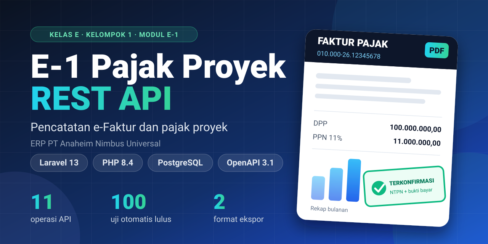
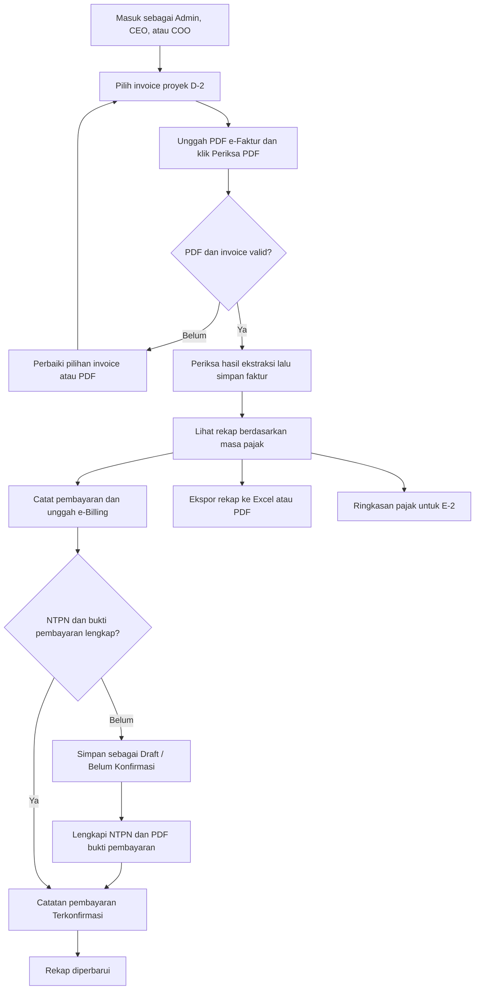

# E-1 — Pencatatan e-Faktur dan Pajak Proyek

<p align="center">
  
</p>

Aplikasi web dan REST API untuk mencatat PDF e-Faktur keluaran, menghubungkannya dengan invoice proyek, serta mendokumentasikan rekap dan pembayaran pajak.

**Capstone Proyek Perangkat Lunak · Kelas E · Kelompok 1**

ERP PT Anaheim Nimbus Universal · Laravel 13 · Blade · Tailwind CSS · PostgreSQL

## Kebutuhan sebelum instalasi

Pasang perangkat berikut terlebih dahulu. Untuk Composer, pasang PHP lebih dulu agar installer dapat menemukan `php.exe`.

| Perangkat | Versi yang digunakan | Kegunaan | Unduhan resmi |
|---|---|---|---|
| **PHP** | 8.4 atau 8.5 | Menjalankan Laravel dan perintah `php artisan` | [PHP](https://www.php.net/downloads.php) · [PHP Windows](https://windows.php.net/download/) |
| **Composer** | 2.x | Memasang dependensi PHP proyek | [Download Composer](https://getcomposer.org/download/) |
| **Node.js dan npm** | Disarankan Node.js **24 LTS**; Node 22 minimal 22.12 juga didukung | Memasang dependensi frontend dan membangun aset. npm sudah disertakan pada installer Node.js | [Download Node.js + npm](https://nodejs.org/en/download) |
| **Podman dan penyedia Compose** | Mendukung `podman compose` | Menjalankan PostgreSQL 16 melalui `compose.yaml` | [Podman](https://podman.io/) |
| **PostgreSQL lokal (alternatif)** | 16 atau lebih baru | Dipakai jika tidak menggunakan container | [Download PostgreSQL](https://www.postgresql.org/download/) |
| **pgAdmin 4 (opsional)** | Sesuai versi PostgreSQL | Melihat dan mengelola database | [Download pgAdmin](https://www.pgadmin.org/download/) |
| **Git** | Versi stabil | Mengambil kode dari repositori | [Download Git](https://git-scm.com/downloads/) |

Gunakan Node.js/npm melalui **nvm** pada Linux atau **nvm-windows** pada Windows. Aktifkan versi Node sebelum menjalankan perintah npm dan ikuti `.nvmrc` bila tersedia. Pada Linux, integrasi juga memerlukan Bash, `setsid`, `nohup`, dan ekstensi PHP `posix`; pada Windows, integrasi memakai PowerShell.

Pastikan `podman compose version` berhasil. Perintah ini memerlukan penyedia Compose seperti `podman-compose`. Jika memilih PostgreSQL lokal di Windows, catat password akun `postgres` serta port instalasinya untuk `.env`.

PHP memerlukan ekstensi `bcmath`, `ctype`, `curl`, `dom`, `fileinfo`, `filter`, `gd`, `mbstring`, `openssl`, `pdo`, `pdo_pgsql`, `session`, `tokenizer`, `xml`, `xmlreader`, `xmlwriter`, dan `zip`. Jika Composer menyebut ekstensi belum tersedia, aktifkan ekstensi tersebut pada `php.ini` yang digunakan PHP CLI. Lokasinya dapat dilihat dengan `php --ini`.

Setelah instalasi perangkat selesai, buka ulang terminal dan pastikan perintah `php`, `composer`, `node`, dan `npm` sudah dikenali.

## Instalasi proyek

Semua perintah berikut dijalankan dari folder **PPL-E-1**. Di VS Code, buka folder proyek lalu pilih **Terminal → New Terminal**.

### 1. Ambil kode proyek

```bash
git clone https://github.com/chandafa/PPL-E-1.git
cd PPL-E-1
```

Jika folder proyek sudah tersedia, cukup buka folder tersebut.

### 2. Pasang dependensi dan build tampilan

```bash
composer install
```

Pada Bash/Linux, aktifkan Node melalui nvm sebelum menjalankan npm:

```bash
source ~/.nvm/nvm.sh
if [ -f .nvmrc ]; then
    nvm install
    nvm use
else
    nvm install 24
    nvm use 24
fi
npm ci
npm run build
```

Pada Windows, aktifkan Node 24 melalui nvm-windows, lalu jalankan `npm ci` dan `npm run build` yang sama. `npm ci` mengikuti lockfile; build menghasilkan `public/build/manifest.json` beserta CSS dan JavaScript. Build harus selesai sebelum membuka aplikasi. Dependensi repo F-1 dan D-2 dipasang oleh `composer integration`.

Jika manifest belum ada saat `composer integration` atau `composer integration run`, perintah integrasi memasang dependensi frontend dan menjalankan build melalui nvm. Terminal tetap memerlukan akses internet untuk mengunduh paket. Build manual di atas juga dapat dipakai untuk memperbarui aset setelah perubahan kode.

### 3. Siapkan konfigurasi .env

Untuk instalasi baru, salin `.env.example` menjadi `.env` melalui Explorer VS Code atau `cp .env.example .env` pada Bash. Jika `.env` sudah ada, edit file tersebut tanpa menimpanya.

Isi atau sesuaikan baris berikut:

```dotenv
# Aplikasi lokal
APP_NAME="E-1 Pajak Proyek"
APP_ENV=local
APP_DEBUG=true
APP_URL=http://127.0.0.1:8087

# PostgreSQL melalui compose.yaml; Laravel berjalan di host
DB_CONNECTION=pgsql
DB_HOST=127.0.0.1
DB_PORT=15439
DB_DATABASE=e1_pajak
DB_USERNAME=e1_app
DB_PASSWORD="ganti_dengan_password_lokal_anda"
```

**Isi `DB_PASSWORD` sebelum menjalankan Compose.** Pada volume baru, Compose membuat database dan akun dari nilai `.env` tersebut.

| Pengaturan | Isi untuk contoh ini | Penjelasan |
|---|---|---|
| `DB_HOST` | `127.0.0.1` | Laravel mengakses PostgreSQL dari host |
| `DB_PORT` | `15439` | Port host yang diteruskan ke port `5432` container |
| `DB_DATABASE` | `e1_pajak` | Database utama E-1 |
| `DB_USERNAME` | `e1_app` | Akun yang dibuat saat inisialisasi volume baru |
| `DB_PASSWORD` | Password lokal Anda | Dipakai oleh Laravel dan Compose |

Untuk PostgreSQL lokal tanpa container, gunakan port instalasinya (umumnya `5432`), akun yang tersedia (misalnya `postgres`), dan password akun tersebut. Buat database `e1_pajak` dengan akun itu sebagai pemilik melalui pgAdmin. Akun integrasi juga memerlukan izin membuat database untuk D-2. Lewati langkah Podman berikut jika memakai PostgreSQL lokal.

Biarkan konfigurasi lainnya mengikuti `.env.example`. `composer integration` akan mengatur koneksi F-1/D-2 dan mematikan login tiruan E-1. Nilai `APP_KEY` disiapkan pada langkah berikutnya.

### 4. Jalankan PostgreSQL melalui Podman (Jika Menggunakan Postgre didalam Container Docker atau Podman jika tidak Skip saja)

```bash
podman compose config --quiet
podman compose up -d
podman compose ps
podman compose exec -T postgres sh -c 'PGPASSWORD="$POSTGRES_PASSWORD" psql -h 127.0.0.1 -U "$POSTGRES_USER" -d "$POSTGRES_DB" -c "SELECT 1"'
```

Pastikan container berjalan dan perintah SQL menghasilkan `1`. Status `healthy` saja belum membuktikan akun database benar. Laravel, npm, F-1, dan D-2 dijalankan di host; Compose ini menjalankan PostgreSQL saja.

Jika volume sudah berisi database, perubahan `DB_USERNAME` dan `DB_PASSWORD` di `.env` tidak membuat ulang akun di dalamnya. Gunakan kredensial yang sesuai dengan volume tersebut. Contohnya, volume lama yang memakai akun `postgres` memerlukan `DB_USERNAME=postgres` dan password akun itu. Jangan menghapus volume untuk mengatasi perbedaan kredensial karena data tersimpan di sana.

### 5. Siapkan key aplikasi

Untuk instalasi baru dengan `APP_KEY` yang belum terisi:

```bash
php artisan key:generate
```

Jika `APP_KEY` sudah tersedia, lanjutkan ke setup integrasi.

Setelah mengubah `.env`, bersihkan cache konfigurasi:

```bash
php artisan config:clear
```

### 6. Setup dan jalankan integrasi

```bash
# Siapkan repo F-1/D-2, dependensi, konfigurasi, migrasi, dan seed
composer integration

# Jalankan F-1, D-2, dan E-1; buat faktur demo dari invoice sumber
composer integration run
```

Setup memerlukan port **4100, 8026, dan 8087** yang kosong. E-1 memakai database utama pada `.env`; D-2 memakai database terpisah yang dibuat otomatis. Migrasi dan seed dijalankan oleh integrasi, sehingga tidak perlu dijalankan manual.

Di Windows dan Linux, `run` memeriksa halaman login serta autentikasi F-1 dan API invoice D-2 pada mode HTTP sebelum membuat faktur demo. Pemeriksaan berlaku juga untuk layanan yang sudah berjalan, dengan maksimal tiga percobaan untuk menunggu startup. Pesan `Integrasi siap` muncul setelah pemeriksaan dan seeding berhasil.

Jika D-2 gagal, pesan membedakan kegagalan koneksi, status HTTP (misalnya 401/403/500), dan format respons. Seed faktur dihentikan; layanan yang sudah berjalan tetap tersedia untuk diperiksa. Lokasi log runtime ditampilkan tanpa menampilkan token atau password. Untuk memeriksa ulang tanpa membuat faktur, gunakan:

```bash
php artisan integration:verify
```

Pada PowerShell, baca log runtime dengan:

```powershell
$runtime = Get-Content -Raw .\storage\app\private\integration\current.json | ConvertFrom-Json
Get-Content -LiteralPath (Join-Path $runtime.directory 'd2-requests.ndjson') -Tail 20
Get-Content -LiteralPath (Join-Path $runtime.directory 'd2.err.log') -Tail 50
```

Status HTTP 500 memerlukan pemeriksaan log aplikasi D-2 di direktori storage yang ditunjuk oleh `$runtime.d2.storage`. Untuk status 401/403, periksa konfigurasi autentikasi F-1/D-2. Jika konfigurasi berubah, gunakan `composer integration:stop`, `composer integration`, lalu `composer integration run` agar proses memakai konfigurasi terbaru.

CI menjalankan test pemeriksaan integrasi pada Windows dan Linux, termasuk argumen path berisi spasi, layanan yang sudah berjalan tetapi API gagal, penolakan autentikasi, respons tidak valid, retry startup, serta penghentian seeding ketika pemeriksaan gagal. Job Windows juga memeriksa sintaks script PowerShell. Test ini memakai API tiruan; instalasi lengkap dengan Podman/PostgreSQL, F-1, dan D-2 tetap perlu diuji pada mesin tujuan.

Setelah layanan siap, buka:

| Halaman | Alamat |
|---|---|
| **Login aplikasi** | http://127.0.0.1:8087/login |
| **Swagger UI** | http://127.0.0.1:8087/docs |
| **Kontrak OpenAPI** | http://127.0.0.1:8087/docs/openapi.yaml |

Login menggunakan akun demo F-1: **`super.admin` / `Password123!`**. Faktur demo beserta PDF dibuat setelah layanan berjalan; pembayaran dicatat melalui aplikasi.

Pastikan halaman login menampilkan formulir beserta tampilannya. Jika muncul `ViteManifestNotFoundException`, aktifkan Node melalui nvm lalu jalankan `npm ci` dan `npm run build` dari folder proyek, kemudian muat ulang halaman. Menjalankan Podman atau server PHP saja belum membangun aset frontend.

Pada Bash/Linux, respons halaman dapat diperiksa dari terminal lain:

```bash
curl -s -o /dev/null -w 'HTTP %{http_code}\n' http://127.0.0.1:8087/login
```

Hasil yang diharapkan adalah `HTTP 200`. Biarkan proses `composer integration run` tetap berjalan selama aplikasi digunakan.

### 7. Pemakaian berikutnya dan menghentikan layanan

```bash
# Pastikan database container berjalan (lewati untuk PostgreSQL lokal)
podman compose up -d

# Jalankan kembali integrasi yang sudah disiapkan
composer integration run

# Hentikan layanan integrasi
composer integration:stop
```

Data yang sudah tersimpan dipertahankan. Jika konfigurasi koneksi berubah, hentikan layanan lalu ulangi `composer integration` sebelum menjalankan `composer integration run`.

Untuk menghentikan PostgreSQL tanpa menghapus datanya, jalankan `podman compose stop`. Setelah memperbarui kode frontend, aktifkan Node melalui nvm dan ulangi `npm ci` serta `npm run build` sebelum membuka aplikasi.

### Alternatif: integrasi dengan D-2 mock

```bash
composer integration:stop
composer integration -- --d2=mock
composer integration run -- --d2=mock
```

Mode ini menjalankan F-1 pada **4100** dan E-1 pada **8087**, dengan referensi snapshot D-2 lokal tanpa server D-2. Gunakan mode yang sama pada setup dan `run`.

Panduan tambahan: [setup anggota](docs/integrasi/SETUP_ANGGOTA.md), [data demo](docs/panduan/DEMO_SEEDER.md), dan [snapshot D-2](docs/panduan/D2_SOURCE_DEMO.md).

## Alur proses



Pratinjau PDF belum menyimpan faktur. Koreksi, pembatalan, dan pencatatan pengganti dilakukan melalui detail faktur; setiap perubahan mempunyai riwayat. Masa pajak pada sampel mengikuti bulan e-Faktur, sedangkan tanggal pembayaran contoh berada pada bulan berikutnya.

## Daftar 11 API

| ID | Metode | Endpoint | Fungsi |
|---|---|---|---|
| API-KE01-01 | `POST` | `/api/v1/tax-invoices/extractions` | Periksa PDF dan tampilkan pratinjau tanpa menyimpan |
| API-KE01-02 | `POST` | `/api/v1/tax-invoices/outgoing` | Simpan faktur keluaran atau pengganti |
| API-KE01-03 | `GET` | `/api/v1/tax-invoices` | Cari, filter, dan tampilkan daftar faktur |
| API-KE01-04 | `GET` | `/api/v1/tax-invoices/{taxInvoiceId}` | Tampilkan detail faktur |
| API-KE01-05 | `PATCH` | `/api/v1/tax-invoices/{taxInvoiceId}` | Koreksi atau batalkan faktur |
| API-KE01-06 | `GET` | `/api/v1/tax-invoices/{taxInvoiceId}/history` | Tampilkan riwayat perubahan |
| API-KE01-07 | `GET` | `/api/v1/tax-recaps/{taxPeriod}` | Tampilkan rekap masa pajak |
| API-KE01-08 | `POST` | `/api/v1/tax-payments` | Catat pembayaran Draft atau Terkonfirmasi |
| API-KE01-09 | `GET` | `/api/v1/tax-recaps/{taxPeriod}/export` | Unduh rekap Excel atau PDF |
| API-KE01-10 | `GET` | `/api/v1/tax/summary` | Baca ringkasan pajak untuk modul lain |
| API-KE01-11 | `PATCH` | `/api/v1/tax-payments/{taxPaymentId}` | Lengkapi NTPN dan bukti pembayaran |

API-09 memerlukan query `format=xlsx` atau `format=pdf`. API-10 memerlukan `taxPeriod=YYYY-MM`; `projectId` bersifat opsional.

Buka **Swagger UI** untuk melihat parameter, mengunggah PDF, dan mencoba API. Bentuk respons, kode kesalahan, serta langkah pengujian lengkap tersedia dalam dokumentasi berikut.

## Dokumentasi lanjutan

| Kebutuhan | Dokumen |
|---|---|
| Memahami halaman dan penggunaan website | [Panduan UI](docs/panduan/UI_BLADE.md) |
| Menggunakan seeder dan pasangan invoice/PDF | [Panduan data demo](docs/panduan/DEMO_SEEDER.md) |
| Menguji API dengan koleksi Postman | [Panduan Postman](docs/api/POSTMAN.md) |
| Melihat respons berhasil dan gagal setiap API | [Referensi respons API](docs/api/RESPON_API.md) |
| Membaca kontrak API | [OpenAPI](openapi.yaml) |
| Melihat seluruh dokumen dan acuan tugas | [Folder dokumentasi](docs/README.md) |

## Tim

**Kelas E · Kelompok 1**

| Anggota |
|---|
| Raden Indra Prawirajaya |
| Muhammad Aidil Fikri |
| Candra Kirana |
| Ismail Abdul Fathan |
| Raihan Azzani Helmawan |

Dependensi: **F-1** untuk identitas dan hak akses, **D-2** untuk invoice proyek. Konsumen ringkasan pajak: **E-2**. `composer integration` menyiapkan kedua repo, migrasi, dan seed; `composer integration run` menjalankan F-1 dan D-2 melalui HTTP bersama E-1. Mode dummy tersedia dengan `--d2=mock`.
