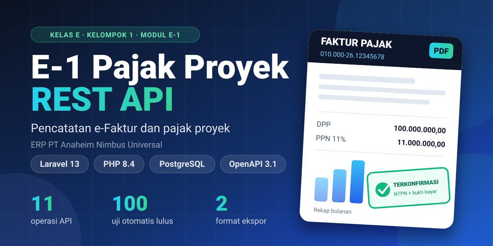
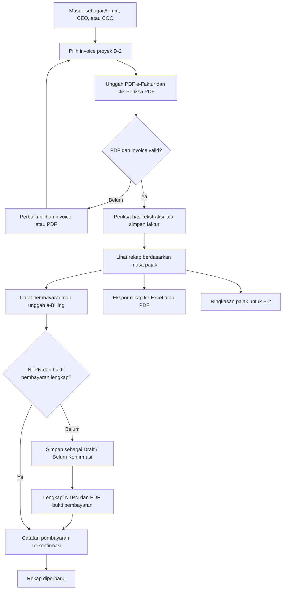

# E-1 — Pencatatan e-Faktur dan Pajak Proyek

<p align="center">
  
</p>

Aplikasi web dan REST API untuk mencatat PDF e-Faktur keluaran, menghubungkannya dengan invoice proyek, serta mendokumentasikan rekap dan pembayaran pajak.

**Capstone Proyek Perangkat Lunak · Kelas E · Kelompok 1**

ERP PT Anaheim Nimbus Universal · Laravel 13 · Blade · Tailwind CSS · PostgreSQL

## Kebutuhan sebelum instalasi

Pasang perangkat berikut terlebih dahulu. Untuk Composer, pasang PHP lebih dulu agar installer dapat menemukan `php.exe`.

| Perangkat | Versi yang digunakan | Kegunaan | Unduhan resmi |
|---|---|---|---|
| **PHP** | 8.4 atau 8.5 | Menjalankan Laravel dan perintah `php artisan` | [PHP](https://www.php.net/downloads.php) · [PHP Windows](https://windows.php.net/download/) |
| **Composer** | 2.x | Memasang dependensi PHP proyek | [Download Composer](https://getcomposer.org/download/) |
| **Node.js dan npm** | Disarankan Node.js **24 LTS**; Node 22 minimal 22.12 juga didukung | Memasang dependensi frontend dan membangun aset. npm sudah disertakan pada installer Node.js | [Download Node.js + npm](https://nodejs.org/en/download) |
| **PostgreSQL** | 16 atau lebih baru; demo diuji pada 18 | Menyimpan data aplikasi | [Download PostgreSQL](https://www.postgresql.org/download/) |
| **pgAdmin 4** | Versi yang mendukung PostgreSQL terpasang | Membuat dan melihat database melalui antarmuka grafis | [Download pgAdmin](https://www.pgadmin.org/download/) |
| **Git** | Versi stabil | Mengambil kode dari repositori | [Download Git](https://git-scm.com/downloads/) |

Saat memasang PostgreSQL di Windows, pilih **PostgreSQL Server** dan **pgAdmin 4**. Catat password akun `postgres` serta port yang dipilih; keduanya dipakai saat mengisi `.env`.

PHP memerlukan ekstensi `bcmath`, `ctype`, `curl`, `dom`, `fileinfo`, `filter`, `gd`, `mbstring`, `openssl`, `pdo`, `pdo_pgsql`, `session`, `tokenizer`, `xml`, `xmlreader`, `xmlwriter`, dan `zip`. Jika Composer menyebut ekstensi belum tersedia, aktifkan ekstensi tersebut pada `php.ini` yang digunakan PHP CLI. Lokasinya dapat dilihat dengan `php --ini`.

Setelah instalasi perangkat selesai, buka ulang terminal dan pastikan perintah `php`, `composer`, `node`, dan `npm` sudah dikenali.

## Instalasi proyek

Semua perintah berikut dijalankan dari folder **PPL-E-1**. Di VS Code, buka folder proyek lalu pilih **Terminal → New Terminal**.

### 1. Ambil kode proyek

```bash
git clone https://github.com/chandafa/PPL-E-1.git
cd PPL-E-1
```

Jika folder proyek sudah tersedia, cukup buka folder tersebut.

### 2. Pasang dependensi dan build tampilan

```bash
composer install
npm install
npm run build
```

`composer install` memasang paket Laravel/PHP. `npm install` memasang paket frontend dan Swagger UI. `npm run build` menyiapkan CSS serta JavaScript untuk tampilan aplikasi.

### 3. Buat database melalui pgAdmin

Langkah ini dilakukan melalui tampilan pgAdmin, tanpa perintah SQL di terminal:

1. Buka **pgAdmin 4** dan hubungkan ke server PostgreSQL lokal. Gunakan akun `postgres` serta password yang ditentukan saat instalasi PostgreSQL.
2. Pada panel kiri, buka **Servers → server PostgreSQL Anda**.
3. Klik kanan **Databases → Create → Database…**.
4. Isi **Database** dengan `e1_pajak` dan **Owner** dengan `postgres`.
5. Klik **Save**. Database `e1_pajak` sekarang tersedia; tabelnya akan dibuat oleh Laravel pada langkah migrasi.

Jika database tersebut sudah ada, gunakan database yang tersedia. Panduan menu tersedia pada [dokumentasi pgAdmin](https://www.pgadmin.org/docs/pgadmin4/latest/database_dialog.html).

### 4. Siapkan konfigurasi .env

Di Explorer VS Code, salin `.env.example`, lalu ubah nama salinannya menjadi `.env`. Jika `.env` sudah ada, edit file tersebut.

Isi atau sesuaikan baris berikut:

```dotenv
# Aplikasi lokal
APP_NAME="E-1 Pajak Proyek"
APP_ENV=local
APP_DEBUG=true
APP_URL=http://127.0.0.1:8080

# Database PostgreSQL yang dibuat melalui pgAdmin
DB_CONNECTION=pgsql
DB_HOST=127.0.0.1
DB_PORT=5432
DB_DATABASE=e1_pajak
DB_USERNAME=postgres
DB_PASSWORD="password_postgresql_anda"

# Demo lokal
D2_DRIVER=mock
E1_DEV_LOGIN=true
```

**Ganti `password_postgresql_anda` dengan password akun PostgreSQL Anda.** Contoh ini menggunakan akun `postgres` untuk menjalankan demo lokal di laptop masing-masing. Jika memakai akun lain, sesuaikan `DB_USERNAME` dan pemilik database.

| Pengaturan | Isi untuk contoh ini | Penjelasan |
|---|---|---|
| `DB_HOST` | `127.0.0.1` | PostgreSQL berjalan di laptop sendiri |
| `DB_PORT` | `5432` | Sesuaikan dengan port yang dipilih saat instalasi PostgreSQL |
| `DB_DATABASE` | `e1_pajak` | Harus sama dengan nama database di pgAdmin |
| `DB_USERNAME` | `postgres` | Akun yang mempunyai akses ke database |
| `DB_PASSWORD` | Password PostgreSQL Anda | Password akun database, bukan master password pgAdmin |
| `D2_DRIVER` | `mock` | Memakai invoice contoh untuk demo lokal |
| `E1_DEV_LOGIN` | `true` | Mengaktifkan login akun demo |

**Perhatikan port:** `.env.example` berisi port `15439` untuk konfigurasi Docker. Pada panduan PostgreSQL lokal melalui pgAdmin ini, ubah menjadi `5432` atau port instalasi Anda.

Biarkan konfigurasi lainnya mengikuti `.env.example` untuk demo lokal. Nilai `APP_KEY` akan diisi otomatis pada langkah berikutnya.

### 5. Buat key, tabel, data demo, dan PDF

Untuk instalasi baru, jalankan berurutan:

```bash
php artisan key:generate
php artisan config:clear
php artisan migrate
php artisan db:seed
php artisan db:seed --class=DemoSeeder
php artisan demo:samples
```

| Perintah | Hasil |
|---|---|
| `php artisan key:generate` | Mengisi `APP_KEY` pada `.env` |
| `php artisan config:clear` | Memuat konfigurasi `.env` terbaru |
| `php artisan migrate` | Membuat tabel yang diperlukan aplikasi |
| `php artisan db:seed` | Mengisi referensi snapshot D-2 lokal: 3 kontrak, 4 termin, 1 parameter pajak, dan invoice `inv-demo-sample` |
| `php artisan db:seed --class=DemoSeeder` | Membuat 32 faktur pajak, 5 pembayaran, dan 5 masa pajak demo |
| `php artisan demo:samples` | Membuat PDF contoh dan memeriksa kembali hasil ekstraksinya |

PDF tersedia di **`docs/postman/samples/`**. Gunakan `manifest.json` untuk mencocokkan PDF dengan invoice, tanggal, dan masa pajak. Hasil pemeriksaannya tercatat di `validation.json`.

Seeder dapat dijalankan ulang dan mempertahankan perubahan pengguna yang sudah tersimpan. Untuk mencoba pencatatan baru, gunakan database baru setelah `db:seed` tanpa `DemoSeeder`, lalu pilih `inv-demo-sample` dan PDF pasangannya. `DemoSeeder` mengisi seluruh 32 faktur contoh, sehingga skenario berikutnya memakai koreksi/pengganti. Lihat [panduan data demo](docs/panduan/DEMO_SEEDER.md).

### 6. Jalankan aplikasi

```bash
composer serve
```

Biarkan terminal tersebut berjalan, lalu buka:

| Halaman | Alamat |
|---|---|
| **Login aplikasi** | http://127.0.0.1:8080/login |
| **Swagger UI** | http://127.0.0.1:8080/docs |
| **Kontrak OpenAPI** | http://127.0.0.1:8080/docs/openapi.yaml |

`composer serve` sudah mengatur batas unggah PHP agar PDF hingga 5 MB dapat diterima aplikasi. Untuk menghentikan server, tekan **Ctrl+C**.

## Integrasi dengan repo F-1 dan D-2

Untuk anggota yang baru memasang proyek, ikuti [setup integrasi di laptop masing-masing](docs/integrasi/SETUP_ANGGOTA.md). Perintah `composer integration` otomatis mengambil F-1/D-2 ke folder `../_integrasi`, memasang dependensi keduanya, lalu menjalankan tiga layanan.

Setelah dependensi E-1 dan PostgreSQL siap, jalankan **composer integration** dari folder PPL-E-1, lalu buka **http://127.0.0.1:8080/login**. Perintah ini mengaktifkan koneksi F-1/D-2 pada `.env` utama, mengambil serta memasang F-1/D-2 jika belum ada di `../_integrasi`, dan menjalankan ketiga layanan. Untuk berhenti, gunakan **composer integration:stop**.

[Langkah uji kelompok dan PDF siap pakai](docs/integrasi/UJI_KELOMPOK.md) tersedia agar tim langsung mencoba alurnya. [Panduan lengkap dan hasil pengujian](docs/integrasi/README.md) menjelaskan profil utama serta suite terpisah. [Temuan F-1/D-2](docs/integrasi/TEMUAN_F1_D2.md) dicatat tanpa mengubah kode kedua kelompok.

`composer integration` boleh dipanggil ulang: jika layanan sudah aktif, perintah menampilkan status berhasil dan mempertahankan prosesnya. Jika hanya sebagian layanan berhenti, bagian tersebut dinyalakan kembali. Tidak perlu menjalankan `composer serve` bersamaan pada port 8080.

## Alur proses



Pratinjau PDF belum menyimpan faktur. Koreksi, pembatalan, dan pencatatan pengganti dilakukan melalui detail faktur; setiap perubahan mempunyai riwayat. Masa pajak pada sampel mengikuti bulan e-Faktur, sedangkan tanggal pembayaran contoh berada pada bulan berikutnya.

## Daftar 11 API

| ID | Metode | Endpoint | Fungsi |
|---|---|---|---|
| API-KE01-01 | `POST` | `/api/v1/tax-invoices/extractions` | Periksa PDF dan tampilkan pratinjau tanpa menyimpan |
| API-KE01-02 | `POST` | `/api/v1/tax-invoices/outgoing` | Simpan faktur keluaran atau pengganti |
| API-KE01-03 | `GET` | `/api/v1/tax-invoices` | Cari, filter, dan tampilkan daftar faktur |
| API-KE01-04 | `GET` | `/api/v1/tax-invoices/{taxInvoiceId}` | Tampilkan detail faktur |
| API-KE01-05 | `PATCH` | `/api/v1/tax-invoices/{taxInvoiceId}` | Koreksi atau batalkan faktur |
| API-KE01-06 | `GET` | `/api/v1/tax-invoices/{taxInvoiceId}/history` | Tampilkan riwayat perubahan |
| API-KE01-07 | `GET` | `/api/v1/tax-recaps/{taxPeriod}` | Tampilkan rekap masa pajak |
| API-KE01-08 | `POST` | `/api/v1/tax-payments` | Catat pembayaran Draft atau Terkonfirmasi |
| API-KE01-09 | `GET` | `/api/v1/tax-recaps/{taxPeriod}/export` | Unduh rekap Excel atau PDF |
| API-KE01-10 | `GET` | `/api/v1/tax/summary` | Baca ringkasan pajak untuk modul lain |
| API-KE01-11 | `PATCH` | `/api/v1/tax-payments/{taxPaymentId}` | Lengkapi NTPN dan bukti pembayaran |

API-09 memerlukan query `format=xlsx` atau `format=pdf`. API-10 memerlukan `taxPeriod=YYYY-MM`; `projectId` bersifat opsional.

Buka **Swagger UI** untuk melihat parameter, mengunggah PDF, dan mencoba API. Bentuk respons, kode kesalahan, serta langkah pengujian lengkap tersedia dalam dokumentasi berikut.

## Dokumentasi lanjutan

| Kebutuhan | Dokumen |
|---|---|
| Memahami halaman dan penggunaan website | [Panduan UI](docs/panduan/UI_BLADE.md) |
| Menggunakan seeder dan pasangan invoice/PDF | [Panduan data demo](docs/panduan/DEMO_SEEDER.md) |
| Menguji API dengan koleksi Postman | [Panduan Postman](docs/api/POSTMAN.md) |
| Melihat respons berhasil dan gagal setiap API | [Referensi respons API](docs/api/RESPON_API.md) |
| Membaca kontrak API | [OpenAPI](openapi.yaml) |
| Melihat seluruh dokumen dan acuan tugas | [Folder dokumentasi](docs/README.md) |

## Tim

**Kelas E · Kelompok 1**

| Anggota |
|---|
| Raden Indra Prawirajaya |
| Aidil |
| Candra |
| Ismail Abdul Fathan |
| Raihan Azzani |

Dependensi: **F-1** untuk identitas dan hak akses, **D-2** untuk invoice proyek. Konsumen ringkasan pajak: **E-2**. `composer integration` memakai layanan repo resmi melalui HTTP; mode mandiri `D2_DRIVER=mock` memakai snapshot lokal.
